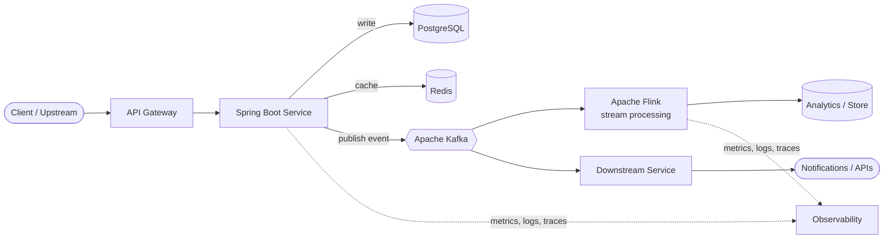

<!-- ═══════════════ HEADER ═══════════════ -->

  

<a href="#-about-me">About</a> ·
<a href="#-core-backend-skills">Skills</a> ·
<a href="#-how-i-design-systems">Architecture</a> ·
<a href="#-featured-projects">Projects</a> ·
<a href="#-ai-engineering">AI</a> ·
<a href="#-lets-connect">Contact</a>

  

 

---

## ⚡ Quick Glance

| 🧑‍💻 Role | 📅 Experience | 🎯 Specialty | 🌍 Open to |
|:---:|:---:|:---:|:---:|
| Backend Software Engineer | 5+ years | Event-driven & high-throughput systems | Backend / Distributed Systems / AI-enabled backend roles |

---

## 👋 About Me

I'm a **Backend Software Engineer** who designs and runs production systems that need to be **fast, reliable and easy to operate**.

My day-to-day: event-driven microservices, stream processing, API design, performance tuning, and making sure systems behave well when things go wrong. I'm also exploring how **LLMs, RAG and agentic workflows** can plug into real backend systems.

- ⚙️ Enterprise backends with **Java 21 + Spring Boot**
- 🔄 Real-time pipelines with **Kafka + Apache Flink**
- 🚀 Tuning throughput, latency and resource usage
- ☁️ Cloud-native deployments on **AWS, Docker, Kubernetes**
- 🤖 Exploring **LLMs, RAG, MCP** and AI-assisted engineering

---

## 🧱 Core Backend Skills

| Area | What I work with |
|---|---|
| **API Design** | REST, gRPC, versioning, pagination, idempotency, validation, error contracts |
| **Microservices** | Service boundaries, inter-service communication, event-driven design, saga / outbox patterns |
| **Messaging & Streaming** | Kafka (partitioning, consumer groups, offsets, retries, DLQ), Flink (windowing, state, exactly-once) |
| **Data & Persistence** | PostgreSQL, MySQL, MongoDB, Redis · indexing, query tuning, transactions, caching strategies |
| **Concurrency & Performance** | Multithreading, virtual threads (Java 21), profiling, JVM tuning, load testing |
| **Resilience** | Timeouts, retries with backoff, circuit breakers, rate limiting, graceful degradation |
| **Observability** | Structured logging, metrics, distributed tracing, alerting, dashboards |
| **Security** | AuthN/AuthZ, OAuth2 / JWT, secrets management, input validation |
| **Testing & Quality** | Unit, integration & contract tests, Testcontainers, code review, clean code |
| **Cloud & DevOps** | AWS, Docker, Kubernetes, Terraform, Jenkins CI/CD, Linux, Git |

---

## 🏗️ How I Design Systems

A simplified view of the event-driven pattern I commonly work with:

**Design priorities:** decouple with events · keep services stateless · make consumers idempotent · plan for retries and failures · measure before optimizing.

---

## 🧩 Engineering Principles

> ⚡ **Performance** should be measured, not assumed.
> 🏗️ **Architecture** should evolve with system requirements.
> 🔄 **Distributed systems** should anticipate failure.
> 🔍 **Observability** is essential for production reliability.
> 🧪 **Testing & maintainability** are part of engineering, not afterthoughts.
> 🤝 **AI** is an engineering multiplier — with human judgment at the center.

---

## 🚀 Featured Projects

<!-- Replace the repo names/descriptions below with your real projects. Delete this comment. -->

**Ideas worth showcasing:** a Kafka + Spring Boot event-driven demo · a Flink streaming job · a rate limiter / circuit-breaker example · a RAG or MCP experiment with a Java backend.

---

## 🛠️ Tech Stack

**Languages & Frameworks**

**Data & Messaging**

**Cloud, DevOps & Observability**

---

## 🤖 AI Engineering

I'm exploring how AI can complement traditional backend engineering.

| Area | Focus |
|---|---|
| 🧠 **LLMs** | Building AI-powered features into applications |
| 🔎 **RAG** | Embeddings, vector search, retrieval strategies |
| 🔌 **MCP** | Model Context Protocol, tools and AI-to-system integrations |
| 🧩 **AI Agents** | Tool use, workflows, agentic systems |
| 🤖 **AI Copilots** | GitHub Copilot and LLM-assisted development |
| ✍️ **Prompt Engineering** | Structured prompts and context design |

---

## 🌱 Currently

- 📖 Going deeper into LLM application architecture and RAG pipelines
- 🔬 Experimenting with MCP servers and integrating AI into Java / Spring Boot backends
- 🧠 Sharpening system design and distributed-systems fundamentals

**💬 Ask me about:** Kafka, Flink, Spring Boot, microservices, performance tuning, system design, AWS.

---

## 📈 GitHub Analytics

---

## 🐍 Contribution Snake

<picture>
  <source media="(prefers-color-scheme: dark)" srcset="https://raw.githubusercontent.com/shubmSingh/shubmSingh/output/github-contribution-grid-snake-dark.svg"/>
  <source media="(prefers-color-scheme: light)" srcset="https://raw.githubusercontent.com/shubmSingh/shubmSingh/output/github-contribution-grid-snake.svg"/>
  
</picture>

---

## 🎓 Certifications

---

## 🤝 Let's Connect

Open to interesting backend, distributed-systems and AI-engineering conversations.

  

**Engineering at scale. Learning beyond boundaries.**

